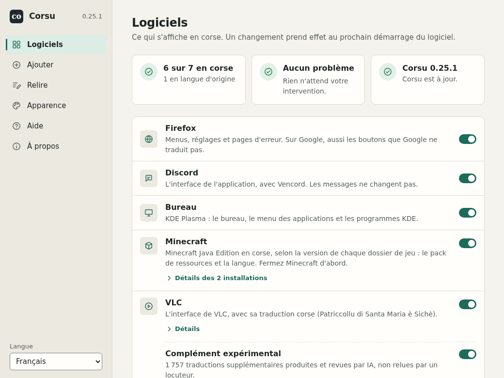
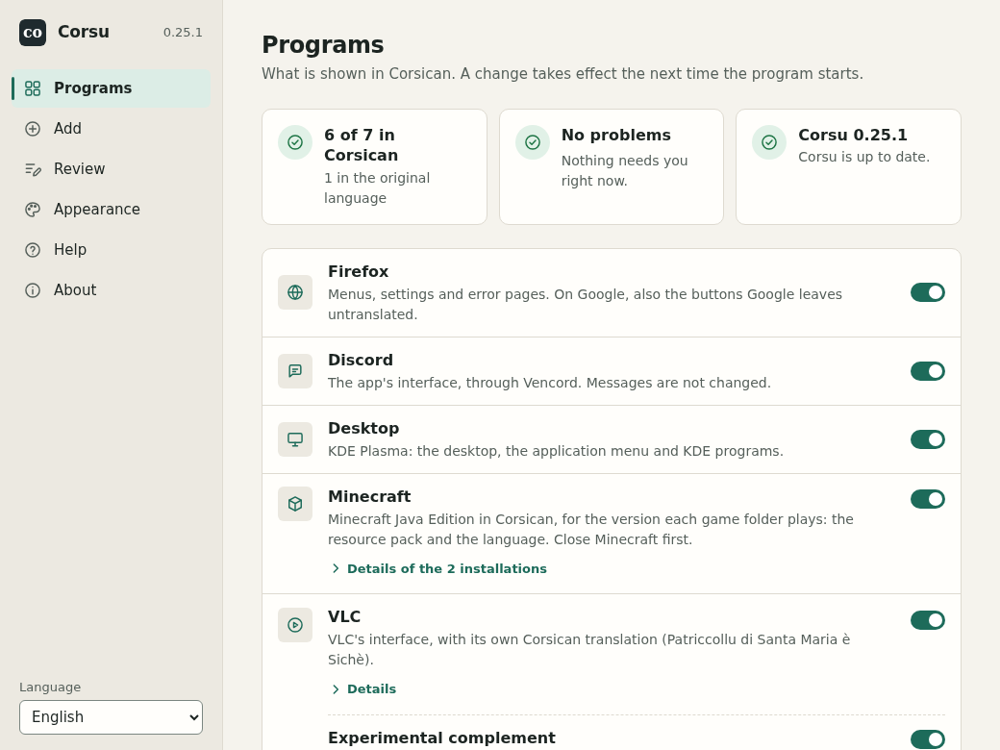

# Corsu

[](https://github.com/Platykalt/corsu/actions/workflows/ci.yml)
[](https://github.com/Platykalt/corsu/releases/latest)
[](LICENSE)

**[Français](#français) · [English](#english)**

Corsu met en corse les logiciels de tous les jours. Corsu puts everyday software in Corsican.

---

## Français

Corsu est un projet libre qui donne au corse une place dans les logiciels de tous les jours. Il y a trois façons de
s'en servir, indépendantes l'une de l'autre. Version publiée : **0.27.0**
([toutes les versions](https://github.com/Platykalt/corsu/releases)).

| Je veux… | Ce qu'il faut | Guide |
| --- | --- | --- |
| des logiciels en corse sur mon ordinateur | l'application Corsu | [Ordinateur](#des-logiciels-en-corse-sur-ordinateur) |
| écrire en corse sur Android ou iPhone | Keyman et le dictionnaire Corsu | [Téléphone](#écrire-en-corse-sur-android-ou-iphone) |
| Minecraft: Java Edition en corse | un pack de ressources | [Minecraft](#minecraft-en-corse) |

### Des logiciels en corse sur ordinateur

L'application Corsu met en corse les menus et les réglages des logiciels installés sur l'ordinateur. Elle montre ce
qui va changer avant de le faire, garde une copie de chaque fichier modifié, et chaque partie peut être remise dans sa
langue d'origine à tout moment.

**Télécharger** (Windows 10 et 11, macOS, Linux x86_64) :

- **Windows** : [corsu-windows.zip](https://github.com/Platykalt/corsu/releases/latest/download/corsu-windows.zip),
  à extraire, puis double-cliquer sur `Install for Windows.cmd` ([guide Windows](docs/fr/ordinateur/windows.md)).
- **macOS** : [corsu-macos.tar.gz](https://github.com/Platykalt/corsu/releases/latest/download/corsu-macos.tar.gz),
  puis double-cliquer sur `Install for macOS.command` ([guide macOS](docs/fr/ordinateur/macos.md)).
- **Linux** : [corsu-linux.tar.gz](https://github.com/Platykalt/corsu/releases/latest/download/corsu-linux.tar.gz),
  puis lancer `./"Install for Linux.sh"` ([guide Linux](docs/fr/ordinateur/linux.md)).

Ou en une ligne, qui télécharge la dernière version et vérifie sa somme SHA-256. Dans PowerShell sous Windows :

```powershell
irm https://raw.githubusercontent.com/Platykalt/corsu/main/install/get.ps1 | iex
```

Dans le Terminal sous macOS ou Linux :

```sh
curl -fsSL https://raw.githubusercontent.com/Platykalt/corsu/main/install/get.sh | sh
```

**Ce que ça change.** Corsu traduit lui-même Firefox et l'application Discord (Windows, macOS, Linux), Google Chrome
(Windows, Linux), et sous Linux seulement le bureau KDE Plasma, les programmes KDE et Qt et les commandes du terminal.
Pour les logiciels qui ont déjà leur traduction corse (VLC, Audacity, Notepad++…, voir
[plus bas](#logiciels-pris-en-charge)), il règle seulement leur langue sur le corse. Il n'installe aucun logiciel.

**Limites.** Firefox en corse est une copie de votre Firefox, ouverte par le raccourci « Firefox Corsu » ; Firefox
en Snap (celui d'Ubuntu) et les versions Flatpak de Firefox, Chrome et Discord ne peuvent pas être traduits. Discord est traduit par
[Vencord](https://vencord.dev), une modification de l'application, et seulement quand sa langue est Français ou
English ([Discord en corse](docs/fr/discord.md)). Le détail système par système :
[Ce qui marche, et où](docs/fr/compatibilite.md) ; fichier par fichier :
[Ce que Corsu modifie](docs/fr/ce-que-corsu-modifie.md).



*La fenêtre de Corsu 0.27.0, avec des données d'exemple.*

**Mettre à jour, réparer, retirer.** Rouvrez l'application Corsu depuis le menu des applications : elle permet
d'ajouter un logiciel, de remettre une partie dans sa langue d'origine (le terminal pendant une heure, par exemple),
de mettre à jour (rubrique À propos) ou de tout retirer. Relancer la commande d'installation fait la même chose que
le bouton de mise à jour : une version plus récente met à jour, la même répare, une plus ancienne est refusée (sauf
avec `--allow-downgrade`). Vos choix sont gardés, et rien de nouveau n'est ajouté sans votre accord.

### Écrire en corse sur Android ou iPhone

Le clavier gratuit [Keyman](https://keyman.com) fournit les touches (disposition EuroLatin (SIL)). Corsu fournit un
dictionnaire qui propose des mots corses pendant que vous écrivez et des corrections d'orthographe. L'application
Corsu pour ordinateur n'est pas nécessaire : le dictionnaire se télécharge seul, sur le téléphone.

**Guides pas à pas : [Android](docs/fr/telephone/android.md) · [iPhone](docs/fr/telephone/iphone.md).**

Dictionnaire publié (le même fichier pour Android et iPhone, paquet 1.2 depuis Corsu 0.27.0) :
[corsu-keyboard.kmp](https://github.com/Platykalt/corsu/releases/latest/download/corsu-keyboard.kmp), 19 341 mots (compte fait dans le paquet publié), dont des noms de lieux historiques (pievi, micro-régions, anciens diocèses ; liste non exhaustive). Deux préférences régionales **expérimentales**, même vocabulaire avec les
formes d'une région en tête (361 mots pondérés autrement, couverture partielle) :
[corsu-keyboard-cismuntincu.kmp](https://github.com/Platykalt/corsu/releases/latest/download/corsu-keyboard-cismuntincu.kmp)
et [corsu-keyboard-pumuntincu.kmp](https://github.com/Platykalt/corsu/releases/latest/download/corsu-keyboard-pumuntincu.kmp).
<!-- corsu:phone-variants:fr Ne lister ci-dessus que les fichiers joints à la dernière version publiée. -->

**Limites.** Ce que fait le dictionnaire dépend de la version de Keyman : Keyman 18, la version stable, n'a pas de
correction automatique ; les corrections sont proposées dans le bandeau de suggestions et ne s'appliquent que si on
les touche.
<!-- corsu:phone-casing:fr La casse tapée est gardée depuis le paquet 1.1 (Corsu 0.26.0). -->
Depuis le paquet 1.1, une suggestion garde la majuscule tapée ; avec l'ancien paquet 1.0, « Ecc » pouvait devenir
« eccu » : mettez-le à jour. Sous Android, une suggestion choisie au milieu d'un mot remplace le mot entier ; sur
iPhone, Keyman n'en remplace que le début. Vérifié dans le moteur de Keyman et sur émulateur Android, pas sur un vrai
téléphone. Depuis le paquet 1.2, aucune espace n'est ajoutée devant une ponctuation déjà écrite. Ce n'est ni un traducteur automatique ni un correcteur de grammaire : Corsu ne traduit pas
les applications du téléphone. Certaines existent déjà en corse (Firefox, VLC, Thunderbird…), voir les guides.

### Minecraft en corse

Un pack de ressources ajoute la langue **Corsu (Corsica)** à Minecraft: Java Edition. C'est un pack de ressources,
pas un shader ni un mod, et il ne touche pas aux fichiers du jeu.

**Sans l'application Corsu**, pour la version 26.3 :

1. Téléchargez [corsu-minecraft-java-26.3.zip](https://github.com/Platykalt/corsu/releases/latest/download/corsu-minecraft-java-26.3.zip)
   et ne le décompressez pas.
2. Dans le jeu : **Options… → Packs de ressources… → Ouvrir le dossier des packs**, déposez-y le fichier, revenez et
   activez le pack (flèche vers la droite), puis **Terminé**.
3. **Options… → Langue…** : choisissez **Corsu (Corsica)**.

Pour une autre version, l'application Corsu installe le pack de la version jouée par chaque dossier de jeu ; les
versions prises en charge et le résultat de chaque vérification sont dans le
[tableau de compatibilité](minecraft/java/COMPATIBILITY.md). Guide complet : [Minecraft en corse](docs/fr/minecraft.md).

<!-- corsu:minecraft-summary:start -->
**Minecraft Java en corse pour 87 versions** (versions stables 1.6.1 → 26.3). Traduction complète des fichiers de langue pour les versions listées ; vérifications techniques avec le code de chaque version. L'application Corsu trouve la version de chaque dossier de jeu, y ajoute le pack de cette version et choisit le corse. Textes écrits par IA, sans relecture par un locuteur ; vérifications automatiques, pas visuelles ; seule la 26.3 a été lancée avec le pack. Disponibilité : dans les versions publiées de Corsu à partir de 0.23.0. Détails et limites : [Minecraft en corse](docs/fr/minecraft.md), [versions et vérifications](minecraft/java/COMPATIBILITY.md).
<!-- corsu:minecraft-summary:end -->

**Limites.** Quatre états sont comptés séparément ([état détaillé](minecraft/java/STATUS.md)) : la traduction est
présente pour les 87 versions ; elle a été relue par IA (en partie pour les textes des anciennes versions) ; aucun
texte n'a été validé par un locuteur ; seule la 26.3 a été lancée avec le pack, sur l'instance du mainteneur, sans
vérification écran par écran. Pas de Bedrock Edition. Ce pack n'est pas un produit officiel Minecraft ; il n'est ni
approuvé par Mojang ou Microsoft, ni associé à eux.

### Logiciels pris en charge

Statuts : **disponible** (dans la version publiée 0.27.0), **expérimental** (disponible, peu vérifié sur ce système),
**candidat** (dans la prochaine version, pas encore publiée), **prévu** (pas encore fait). Le détail, avec les
vérifications faites pour chacun : [État des traductions](docs/fr/etat-des-traductions.md).

**Traduits par Corsu**

| Logiciel (systèmes) | Statut |
| --- | --- |
| Firefox (Windows, macOS, Linux) | disponible |
| Application Discord (Windows, macOS, Linux) | disponible, traduction partielle |
| Google Chrome (Windows, Linux) | disponible |
| Opera GX et autres navigateurs Chromium (Windows, Linux) | expérimental |
| Bureau KDE Plasma, programmes KDE et Qt (Linux) | disponible |
| Commandes du terminal, programmes GTK (Linux) | expérimental |
| Minecraft: Java Edition (Windows, macOS, Linux) | disponible, relu par IA seulement |

**Déjà traduits en corse en amont : Corsu active leur traduction**

Ces logiciels contiennent leur propre traduction corse, faite dans leur projet, le plus souvent par
Patriccollu di Santa Maria è Sichè. Corsu change seulement leur réglage de langue, et le rend à la désactivation.

| Logiciel (systèmes) | Statut |
| --- | --- |
| VLC (Windows, macOS, Linux) | disponible |
| Complément corse de VLC, textes IA relus par IA (Linux) | expérimental, désactivé par défaut |
| Audacity 3, Tenacity (Windows, macOS, Linux) | disponible |
| Audacity 4 (Linux) | disponible |
| Audacity 4 (Windows, macOS) | expérimental |
| fre:ac (Windows, Linux) | disponible |
| Poedit (Linux, Windows) | disponible |
| Poedit (macOS) | expérimental |
| PDFsam Basic (Windows, Linux) | disponible |
| FileZilla, HandBrake, VeraCrypt (Windows, Linux) | disponible |
| 7-Zip, Notepad++, WinMerge, SumatraPDF (Windows) | disponible |

**Repris seulement comme vocabulaire de référence.** Les traductions corses de Firefox pour Android et iOS,
Thunderbird pour Android, VLC pour Android, OpenTracks, Mozilla VPN, wxWidgets et Inno Setup servent à traduire
d'autres logiciels de façon cohérente ; Corsu ne modifie pas ces applications.

**Minecraft Bedrock** : prototype, non validé en jeu ([état](minecraft/bedrock/STATUS.md)).

**Envisagés, pas commencés** : Vesktop, Discord dans un navigateur, jeux et autres logiciels : [feuille de route](docs/fr/feuille-de-route.md).

### Les traductions : d'où elles viennent

Le lexique de Corsu compte environ 138 000 lignes, chacune un texte source et sa traduction corse.

- **Plus de 18 000 sont reprises de logiciels libres déjà traduits en corse**, pour la plupart par
  Patriccollu di Santa Maria è Sichè, qui traduit depuis des années de nombreux logiciels dans leurs propres projets
  (sa liste : [Lingua_Corsa-Infurmatica](https://github.com/Patriccollu/Lingua_Corsa-Infurmatica)), et par l'équipe
  corse de Mozilla. Elles gardent leur licence ([lexicon/](lexicon/)) et leur texte publié ; les adaptations de Corsu
  sont à part ([lexicon-fixes.tsv](lexicon/lexicon-fixes.tsv), [corrections.tsv](lexicon/corrections.tsv)).
- **Les autres ont été écrites pour Corsu**, avec le même vocabulaire, dont plus de 23 000 pour Discord et Vencord.
  Ce sont des premières versions. Environ 118 500 lignes de [lexicon.tsv](lexicon/lexicon.tsv) ont été ajoutées ou
  modifiées dans des commits cosignés par un assistant IA (Claude), comme les textes de Minecraft et du complément
  VLC ; 872 lignes, déjà présentes au premier commit, ont une origine non documentée et ne sont pas comptées comme
  humaines ([provenance du lexique](lexicon/PROVENANCE.md)). Les relectures
  faites jusqu'ici sont surtout des relectures par IA : elles trouvent des erreurs mais ne valent pas validation, et
  les relectures par un locuteur sont comptées à part ([REVIEWS.md](lexicon/REVIEWS.md)).
- **Sources consultées.** Pour vérifier un mot, Corsu consulte des ressources publiques : INFCOR (ADECEC), la BDLC
  (Università di Corsica), Educorsica (Canopé), Wiktionary, Vikipedia, Apertium… ([liste et conditions
  d'usage](resources/README.md)). Les consulter ne veut pas dire que ces organismes ont relu ou approuvé Corsu : aucun
  ne l'a fait. Les droits d'un éditeur portent sur son œuvre ou sa base de données (un dictionnaire, un tableau, une
  base comme INFCOR), pas sur les mots eux-mêmes : un mot corse n'appartient à personne. Corsu ne copie pas ces
  ouvrages ; il y vérifie des mots un par un et dit lesquels. Pour le clavier,
  les formes verbales vérifiées dans *U Cunghjugarellu* (Canopé) et ce qui en entre dans les paquets sont décrits à
  part ([sources du clavier](docs/keyboard-sources.md#u-cunghjugarellu-canopé-de-corse)).

Une traduction vous paraît fausse ? [Ouvrez un ticket](https://github.com/Platykalt/corsu/issues/new?template=translation.yml)
ou corrigez-la : [CONTRIBUTING.md](CONTRIBUTING.md). Règles de traduction et de provenance : [AGENTS.md](AGENTS.md).

### Pourquoi Corsu

Apprendre une langue, savoir la parler et avoir des occasions de s'en servir sont trois choses différentes.
Beaucoup de Corses, surtout sur la côte et en ville, n'ont pas d'endroit où pratiquer le corse en dehors de l'école,
alors que ce sont eux qui passent le plus de temps en ligne. Et de nombreux locuteurs ne parlent pas corse parce que
la langue leur semble décalée dans le contexte où ils se trouvent.

L'irlandais montre cet écart : au recensement de 2022, 1 873 997 personnes en République d'Irlande déclaraient savoir
le parler, mais 71 968 seulement le parlaient tous les jours en dehors du système éducatif
([CSO, recensement 2022](https://www.cso.ie/en/releasesandpublications/ep/p-cpp8/censusofpopulation2022profile8-theirishlanguageandeducation/irishlanguageandthegaeltacht/)).

Corsu a deux objectifs :

1. **Rendre le corse familier au quotidien**, en le faisant rencontrer dans les interfaces qu'on utilise tous les
   jours. Cet apprentissage passif complète les cours et la conversation.
2. **Donner au corse plus d'endroits où il paraît naturel**, à commencer par les ordinateurs et les téléphones, pour
   qu'il devienne une langue normale pour s'exprimer en ligne.

Une interface traduite ne remplace pas les échanges entre locuteurs. Pour pratiquer le corse, même sans personne à
qui le parler : [Sapienzia](https://www.sapienzia.io) (traduction, dictionnaire, conjugaison, conversation),
[Astutu](https://astutu.corsica) (assistant qui répond en corse), [LIV](https://liv.corsica) (une IA qui parle corse).
La version longue : [Pourquoi Corsu](docs/fr/pourquoi-corsu.md).

### Pour aller plus loin

[Toute la documentation](docs/README.md) · [Développement](docs/fr/developpeurs.md) · [Sécurité](SECURITY.md) ·
[Historique des versions](CHANGELOG.md) · [Crédits](CREDITS.md)

---

## English

Corsu is a free software project that gives Corsican a place in everyday software. There are three ways to use it,
independent of each other. Published release: **0.27.0**
([all releases](https://github.com/Platykalt/corsu/releases)).

| I want… | What it takes | Guide |
| --- | --- | --- |
| programs in Corsican on my computer | the Corsu app | [Computer](#programs-in-corsican-on-a-computer) |
| to write Corsican on Android or iPhone | Keyman and the Corsu dictionary | [Phone](#write-corsican-on-android-or-iphone) |
| Minecraft: Java Edition in Corsican | a resource pack | [Minecraft](#minecraft-in-corsican) |

### Programs in Corsican on a computer

The Corsu app puts the menus and settings of the programs on your computer in Corsican. It shows what will change
before doing it, keeps a copy of every file it changes, and each part can be put back in its original language at
any time.

**Download** (Windows 10 and 11, macOS, Linux x86_64):

- **Windows**: [corsu-windows.zip](https://github.com/Platykalt/corsu/releases/latest/download/corsu-windows.zip),
  extract it, then double-click `Install for Windows.cmd` ([Windows guide](docs/en/computer/windows.md)).
- **macOS**: [corsu-macos.tar.gz](https://github.com/Platykalt/corsu/releases/latest/download/corsu-macos.tar.gz),
  then double-click `Install for macOS.command` ([macOS guide](docs/en/computer/macos.md)).
- **Linux**: [corsu-linux.tar.gz](https://github.com/Platykalt/corsu/releases/latest/download/corsu-linux.tar.gz),
  then run `./"Install for Linux.sh"` ([Linux guide](docs/en/computer/linux.md)).

Or in one line, which downloads the latest release and checks its SHA-256. In PowerShell on Windows:

```powershell
irm https://raw.githubusercontent.com/Platykalt/corsu/main/install/get.ps1 | iex
```

In Terminal on macOS or Linux:

```sh
curl -fsSL https://raw.githubusercontent.com/Platykalt/corsu/main/install/get.sh | sh
```

**What it changes.** Corsu translates Firefox and the Discord app itself (Windows, macOS, Linux), Google Chrome
(Windows, Linux), and on Linux only the KDE Plasma desktop, KDE and Qt programs and terminal commands. For programs
that already have their own Corsican translation (VLC, Audacity, Notepad++…, see [below](#supported-programs)), it
only sets their language to Corsican. It installs no program.

**Limits.** Firefox in Corsican is a copy of your Firefox, opened from the "Firefox Corsu" shortcut; Firefox as a
Snap (Ubuntu's) and the Flatpak versions of Firefox, Chrome and Discord cannot be translated. Discord is translated through [Vencord](https://vencord.dev),
a modification of the app, and only when its language is Français or English
([Discord in Corsican](docs/en/discord.md)). Details for each system: [What works where](docs/en/compatibility.md);
file by file: [What Corsu changes](docs/en/what-corsu-changes.md).



*The Corsu 0.27.0 window, with sample data.*

**Updating, repairing, removing.** Open the Corsu app again from the applications menu to add a program, put a part
back in its original language (the terminal for an hour, for example), update (in About) or remove everything.
Running the install command again does the same as the Update button: a newer release updates, the same one
repairs, an older one is refused (unless you add `--allow-downgrade`). Your choices are kept, and nothing new is
added unless you select it.

### Write Corsican on Android or iPhone

The free [Keyman](https://keyman.com) keyboard gives the keys (EuroLatin (SIL) layout). Corsu gives a dictionary
that suggests Corsican words as you type and offers spelling corrections. The Corsu desktop app is not needed: the
dictionary is downloaded on its own, on the phone.

**Step-by-step guides: [Android](docs/en/phone/android.md) · [iPhone](docs/en/phone/iphone.md).**

Published dictionary (the same file for Android and iPhone, package 1.2 since Corsu 0.27.0):
[corsu-keyboard.kmp](https://github.com/Platykalt/corsu/releases/latest/download/corsu-keyboard.kmp), 19,341 words (counted in the published package), including historical place names (pievi, micro-regions, former dioceses; not an exhaustive list). Two **experimental** regional preferences, same vocabulary with one
region's forms first (361 words weighted differently, partial coverage):
[corsu-keyboard-cismuntincu.kmp](https://github.com/Platykalt/corsu/releases/latest/download/corsu-keyboard-cismuntincu.kmp)
and [corsu-keyboard-pumuntincu.kmp](https://github.com/Platykalt/corsu/releases/latest/download/corsu-keyboard-pumuntincu.kmp).
<!-- corsu:phone-variants:en List above only the files attached to the latest published release. -->

**Limits.** What the dictionary does depends on the Keyman version: Keyman 18, the stable version, has no automatic
correction; corrections are offered in the suggestion banner and only apply when you tap them.
<!-- corsu:phone-casing:en The case typed is kept since package 1.1 (Corsu 0.26.0). -->
Since package 1.1 a suggestion keeps the capital you typed; with the old 1.0 package "Ecc" could become "eccu":
update it. On Android a suggestion chosen inside a word replaces the whole word; on iPhone Keyman replaces only its
beginning. Checked in Keyman's engine and on an Android emulator, not on a real phone. Since package 1.2 no space is added before punctuation already in the text. It is neither an automatic translator nor a grammar checker: Corsu does not translate phone apps.
Some already exist in Corsican (Firefox, VLC, Thunderbird…), see the guides.

### Minecraft in Corsican

A resource pack adds the language **Corsu (Corsica)** to Minecraft: Java Edition. It is a resource pack, not a
shader or a mod, and it does not touch the game's files.

**Without the Corsu app**, for version 26.3:

1. Download [corsu-minecraft-java-26.3.zip](https://github.com/Platykalt/corsu/releases/latest/download/corsu-minecraft-java-26.3.zip)
   and do not extract it.
2. In the game: **Options… → Resource Packs… → Open Pack Folder**, drop the file there, go back and switch the pack
   on (arrow to the right), then **Done**.
3. **Options… → Language…**: choose **Corsu (Corsica)**.

For another version, the Corsu app installs the pack of the version each game folder plays; supported versions and
each check's result are in the [compatibility table](minecraft/java/COMPATIBILITY.md). Full guide:
[Minecraft in Corsican](docs/en/minecraft.md).

<!-- corsu:minecraft-summary:start -->
**Minecraft: Java Edition in Corsican for 87 versions** (releases 1.6.1 → 26.3). Complete translation of the language files for the listed versions; technical checks with each version's own code. The Corsu app finds the version of each game folder, adds that version's pack and picks Corsican. AI-written texts, not reviewed by a speaker; automated checks, not visual ones; only 26.3 has been started with the pack. Availability: in published Corsu releases from 0.23.0. Details and limits: [Minecraft in Corsican](docs/en/minecraft.md), [versions and checks](minecraft/java/COMPATIBILITY.md).
<!-- corsu:minecraft-summary:end -->

**Limits.** Four states are counted separately ([detailed status](minecraft/java/STATUS.md)): the translation is
present for the 87 versions; it was reviewed by AI (only partly for the older versions' texts); no text has been
validated by a speaker; only 26.3 has been started with the pack, on the maintainer's instance, without a screen by
screen check. No Bedrock Edition. NOT AN OFFICIAL MINECRAFT PRODUCT. NOT APPROVED BY OR ASSOCIATED WITH MOJANG OR
MICROSOFT.

### Supported programs

Statuses: **available** (in the published release 0.27.0), **experimental** (available, little checked on that
system), **candidate** (in the next version, not published yet), **planned** (not done yet). Details, with the checks
made for each: [Translation status](docs/en/translation-status.md).

**Translated by Corsu**

| Program (systems) | Status |
| --- | --- |
| Firefox (Windows, macOS, Linux) | available |
| Discord app (Windows, macOS, Linux) | available, partial translation |
| Google Chrome (Windows, Linux) | available |
| Opera GX and other Chromium browsers (Windows, Linux) | experimental |
| KDE Plasma desktop, KDE and Qt programs (Linux) | available |
| Terminal commands, GTK programs (Linux) | experimental |
| Minecraft: Java Edition (Windows, macOS, Linux) | available, reviewed by AI only |

**Already translated into Corsican upstream: Corsu switches their translation on**

These programs carry their own Corsican translation, made in their own project, most often by
Patriccollu di Santa Maria è Sichè. Corsu only changes their language setting, and gives it back when switched off.

| Program (systems) | Status |
| --- | --- |
| VLC (Windows, macOS, Linux) | available |
| VLC Corsican complement, AI texts reviewed by AI (Linux) | experimental, off by default |
| Audacity 3, Tenacity (Windows, macOS, Linux) | available |
| Audacity 4 (Linux) | available |
| Audacity 4 (Windows, macOS) | experimental |
| fre:ac (Windows, Linux) | available |
| Poedit (Linux, Windows) | available |
| Poedit (macOS) | experimental |
| PDFsam Basic (Windows, Linux) | available |
| FileZilla, HandBrake, VeraCrypt (Windows, Linux) | available |
| 7-Zip, Notepad++, WinMerge, SumatraPDF (Windows) | available |

**Taken only as reference vocabulary.** The Corsican translations of Firefox for Android and iOS, Thunderbird for
Android, VLC for Android, OpenTracks, Mozilla VPN, wxWidgets and Inno Setup help translate other programs
consistently; Corsu does not change those apps.

**Minecraft Bedrock**: prototype, not validated in the game ([status](minecraft/bedrock/STATUS.md)).

**Considered, not started**: Vesktop, Discord in a browser,
games and other programs: [roadmap](docs/en/roadmap.md).

### Translations: where they come from

Corsu's lexicon has about 138,000 lines, each a source text and its Corsican translation.

- **More than 18,000 are taken from free software already translated into Corsican**, most of them by
  Patriccollu di Santa Maria è Sichè, who has translated many programs for years within their own projects (the
  list: [Lingua_Corsa-Infurmatica](https://github.com/Patriccollu/Lingua_Corsa-Infurmatica)), and by the Corsican
  Mozilla team. They keep their licence ([lexicon/](lexicon/)) and their published text; Corsu's adaptations are kept
  apart ([lexicon-fixes.tsv](lexicon/lexicon-fixes.tsv), [corrections.tsv](lexicon/corrections.tsv)).
- **The rest were written for Corsu**, with the same vocabulary, more than 23,000 of them for Discord and Vencord.
  They are first versions. About 118,500 rows of [lexicon.tsv](lexicon/lexicon.tsv) were added or changed in commits
  co-signed by an AI assistant (Claude), as were the Minecraft and VLC complement texts; 872 rows, already there in the
  first commit, have an undocumented origin and are not counted as human ([lexicon provenance](lexicon/PROVENANCE.md)).
  The reviews made so far are
  mostly AI reviews: they find mistakes but are not a validation, and reviews by a speaker are counted apart
  ([REVIEWS.md](lexicon/REVIEWS.md)).
- **Sources consulted.** To check a word, Corsu consults public resources: INFCOR (ADECEC), the BDLC (Università di
  Corsica), Educorsica (Canopé), Wiktionary, Vikipedia, Apertium… ([list and terms of use](resources/README.md)).
  Consulting them does not mean these organisations reviewed or approved Corsu: none has. A publisher's rights cover
  its work or its database (a dictionary, a table, a database such as INFCOR), not the words themselves: a Corsican
  word belongs to nobody. Corsu does not copy these works; it checks words in them one by one and says which. For the keyboard, the verb forms checked in
  *U Cunghjugarellu* (Canopé) and what reaches the packages are described apart
  ([keyboard sources](docs/keyboard-sources.md#u-cunghjugarellu-canopé-de-corse)).

Does a translation look wrong? [Open an issue](https://github.com/Platykalt/corsu/issues/new?template=translation.yml)
or correct it: [CONTRIBUTING.md](CONTRIBUTING.md). Translation and provenance rules: [AGENTS.md](AGENTS.md).

### Why Corsu

Learning a language, being able to speak it and having occasions to use it are three different things. Many
Corsicans, especially on the coast and in towns, have nowhere to practise Corsican outside school, while they are the
people who spend the most time online. And many speakers do not use Corsican because it feels out of place in the
situations they are in.

Irish shows the gap: in the 2022 census, 1,873,997 people in the Republic of Ireland said they could speak it, but
only 71,968 spoke it every day outside the education system ([CSO, Census 2022](https://www.cso.ie/en/releasesandpublications/ep/p-cpp8/censusofpopulation2022profile8-theirishlanguageandeducation/irishlanguageandthegaeltacht/)).

Corsu has two goals:

1. **Make Corsican familiar every day**, by meeting it in the interfaces people use daily. This passive learning adds
   to lessons and conversation.
2. **Give Corsican more places where it feels natural**, starting with computers and phones, so that it becomes a
   normal language to express yourself online.

A translated interface does not replace talking with other speakers. To practise Corsican, even with nobody around
to speak it with: [Sapienzia](https://www.sapienzia.io) (translation, dictionary, conjugation, conversation),
[Astutu](https://astutu.corsica) (an assistant that answers in Corsican), [LIV](https://liv.corsica) (an AI that
speaks Corsican). The long version: [Why Corsu](docs/en/why-corsu.md).

### More

[All the documentation](docs/README.md) · [Development](docs/en/developers.md) · [Security](SECURITY.md) ·
[Release history](CHANGELOG.md) · [Credits](CREDITS.md)

---

Corsu est un logiciel libre sous [licence GNU GPL](LICENSE), version 3 ou ultérieure · Corsu is free software under the
[GNU GPL](LICENSE), version 3 or later. Les traductions reprises d'autres projets gardent leur licence, indiquée dans
[lexicon/](lexicon/) · Translations taken from other projects keep their own licence, given in [lexicon/](lexicon/).
