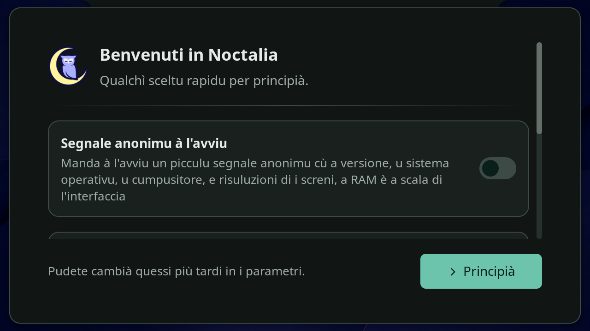
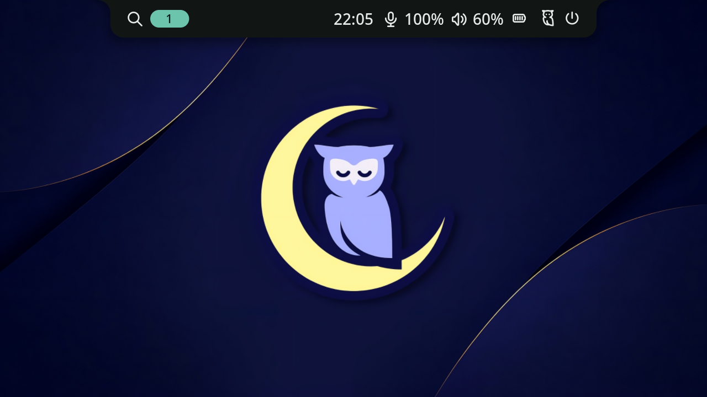
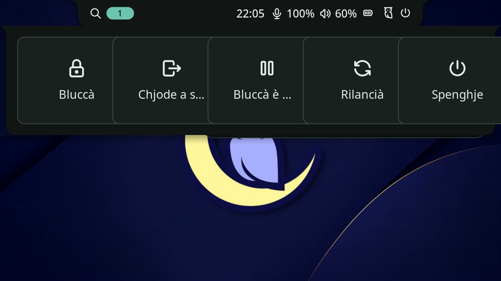

# Hyprland et Noctalia

[English](../en/hyprland.md)

> **Statut : en développement, pas dans la version publiée.** Le code est sur la branche de développement
> [`hyprland`](https://github.com/Platykalt/corsu/tree/hyprland), à part de la version stable : la version publiée,
> 0.28.1, ne le contient pas. Linux seulement ; vérifié seulement sur CachyOS avec Hyprland 0.56.2 et Noctalia
> 5.3.0, et une partie des essais reste à faire ([Vérifications](#vérifications)). Facultatif : installer Corsu ne
> remplace jamais votre bureau ; ces parties se choisissent une à une et la session Plasma reste.

[Hyprland](https://hyprland.org) est un bureau pour Linux où les fenêtres se rangent seules côte à côte ; Noctalia y
ajoute la barre du haut, le lanceur d'applications, les notifications, l'écran de verrouillage et les réglages. Corsu
apporte :

- **la traduction corse de Noctalia**, et le corse d'abord pour les programmes lancés dans la session Hyprland ;
- **au choix, un profil de bureau Corsu** : des raccourcis clavier prêts, l'apparence Corsu (palettes maquis et mer)
  et une configuration guidée depuis la fenêtre de Corsu, qui détecte ce qui est installé, explique chaque choix et
  sait tout retirer.

**Corsu n'installe jamais de bureau** : vous installez Hyprland et Noctalia avec votre distribution, Corsu les
détecte. Plasma reste installé et choisissable à chaque connexion.

## Vérifications

État au 23 octobre 2026, sur un seul ordinateur : le portable du mainteneur sous CachyOS (Intel + NVIDIA RTX 5070,
écran interne relié à la NVIDIA), Hyprland 0.56.2, Noctalia 5.3.0, uwsm 0.27.1, portail Hyprland 1.4.1.

**Fait**

- Configuration validée par `Hyprland --verify-config` et `noctalia config validate`.
- Vrai Hyprland dans une **session de test imbriquée** (Hyprland lancé dans un KWin virtuel sans écran, bus D-Bus
  privé, bus système masqué) : configuration chargée sans erreur, 66 raccourcis enregistrés, clavier `fr`, Noctalia
  démarré et en corse (accueil, barre, menu de session, aide des touches). Captures [plus bas](#captures).
- Version de développement 0.28.0 de la branche installée sur cet ordinateur avec les deux parties ; retour à la
  0.27.0, alors la version publiée, essayé dans un dossier jetable.
- Une vraie connexion à Hyprland a atteint le bureau ; le portefeuille KWallet a demandé son mot de passe et s'est
  ouvert une fois ce mot de passe tapé. Cela confirme seulement cette étape, pas le reste de la session.
- CI : la dernière exécution réussie de la branche ([39846551021](https://github.com/Platykalt/corsu/actions/runs/39846551021))
  porte sur le commit `d687579` ; les commits suivants de la branche n'ont pas encore de CI réussie.

**Reste à vérifier**

- Un vrai usage de la session : raccourcis tapés sur le clavier AZERTY, lanceur, réglages, réseau, Bluetooth.
- La double carte graphique (écran interne relié à la NVIDIA).
- Batterie et luminosité.
- Mise en veille et reprise, fermeture du capot.
- Verrouillage et déverrouillage.
- Partage d'écran : un vrai partage dans Firefox, Discord ou OBS (lancer le programme ne suffit pas).
- Portails (sélecteur de fichiers, captures d'écran).
- Authentification administrateur (fenêtre de mot de passe polkit).
- Les autres distributions que CachyOS.
- Le corse de Noctalia : sur 3 126 textes, 382 reprennent une traduction corse publiée, 267 l'usage existant de
  Corsu, 2 375 sont des propositions IA ; aucun texte relu par un locuteur
  ([provenance](https://github.com/Platykalt/corsu/blob/hyprland/src/hyprland/translations/PROVENANCE.md)).

## Captures

*Environnement de test (session imbriquée)*, pas une vraie connexion : écran virtuel 1280 × 720, sans réseau ni
Bluetooth. Sur un vrai écran, la barre montre aussi réseau, Bluetooth, zone de notification et luminosité.

| Accueil de Noctalia (langue seule, sans le profil) | Barre (avec le profil) | Menu de session |
| --- | --- | --- |
|  |  |  |

Avec le profil, l'accueil ne s'ouvre pas : il enregistrerait ses propres couleurs par-dessus celles de Corsu. Dans le
menu de session, Noctalia coupe les noms trop longs (« Chjode a s… » pour « Chjode a sessione »).

## Ce qu'il faut installer

| Paquet | Pour quoi |
| --- | --- |
| `hyprland` (0.55 ou plus récent) | le bureau ; le profil utilise sa configuration en Lua |
| `noctalia` (5.x) | la barre, le lanceur, les notifications, le verrouillage |
| `uwsm` | lance la session ; la langue de la session passe par `~/.config/uwsm/env-hyprland`, que seul uwsm lit |
| `xdg-desktop-portal-hyprland` | les portails de la session Hyprland (captures, partage d'écran) |
| `qt6ct` (conseillé avec le profil) | les couleurs des programmes Qt dans la session Hyprland seulement |

Sur l'ordinateur de test (CachyOS), ont aussi été installés `wl-clipboard`, `cliphist`, `brightnessctl` et `libnewt`
(ce dernier sert au menu `uwsm start select`) ; Corsu ne les demande pas. Sur CachyOS, avec le mot de passe
administrateur :

```sh
sudo pacman -S hyprland noctalia uwsm xdg-desktop-portal-hyprland qt6ct
```

N'installez pas le préréglage `cachyos-hypr-noctalia` : il entre en conflit avec `cachyos-kde-settings`, qui porte la
configuration de l'écran de connexion de Plasma. Sur une autre distribution, les noms et la disponibilité des paquets
peuvent différer ; ce n'est pas encore essayé.

## Obtenir la version de développement

Ces parties ne sont dans aucune version publiée : la commande d'installation habituelle installe 0.28.1, sans elles.
Pour les essayer, il faut prendre la branche `hyprland` ; c'est pour les testeurs, pas pour un usage quotidien.

```sh
git clone --branch hyprland https://github.com/Platykalt/corsu.git corsu-hyprland
cd corsu-hyprland
./install/"Install for Linux.sh"
```

La fenêtre de Corsu s'ouvre. Dans **Ajouter**, cochez **Hyprland et Noctalia** et, si vous le voulez,
**Profil de bureau Corsu pour Hyprland**, puis suivez les étapes. Attention : cela remplace le Corsu installé par la
version de développement, qui se présente aussi comme 0.28.1 mais n'est pas la 0.28.1 publiée. Pour revenir à la version
publiée, voir [Revenir en arrière](#revenir-en-arrière).

## Deux choix séparés

- **Hyprland et Noctalia** (`hyprland`, la langue) : le catalogue corse de Corsu pour Noctalia et sa langue réglée
  sur le corse ; dans la session Hyprland, le corse d'abord pour les programmes, puis vos langues et l'anglais pour
  ce qui n'est pas encore traduit (`LANGUAGE=co:fr_FR:en` par exemple). Rien de visuel ne change. Cochée d'avance
  seulement si Corsu trouve un Hyprland compatible **et** Noctalia 5 ; sinon proposée décochée, ou grisée avec la
  raison.
- **Profil de bureau Corsu pour Hyprland** (`hyprland-profile`), **jamais coché d'avance** : des modules Lua prêts
  (touches, fenêtres, entrée), les portails de la session Hyprland et l'apparence Corsu pour Noctalia. On peut prendre
  la langue sans le profil, ou le profil sans la langue.

Le profil cache Noctalia du menu de Plasma (lancé depuis Plasma, il ajouterait un second panneau par-dessus celui de
Plasma) : c'est le seul changement visible dans Plasma, et il disparaît avec le profil. Corsu dit ce qu'il trouve dans
la fenêtre (page « Ajouter »), dans `corsu.py status` (rubrique `hyprland`) et dans le menu texte (`app.py --text`).

## Première connexion

1. **Enregistrez vos documents et fermez vos programmes** : changer de session ferme tout ce qui est ouvert.
2. Déconnectez-vous de Plasma.
3. Sur l'écran de connexion, choisissez la session **« Hyprland (uwsm-managed) »** (la liste des sessions est en
   général en bas de l'écran), puis tapez votre mot de passe. Prenez bien cette entrée : la langue de la session et
   l'arrêt propre en dépendent. L'écran de connexion retient ensuite la dernière session choisie.
4. **Le portefeuille KWallet** peut demander un mot de passe. C'est le coffre où Plasma garde vos mots de passe
   enregistrés (Wi-Fi, comptes, navigateur). Son mot de passe peut être différent de celui de la connexion : tapez
   **le mot de passe du portefeuille**. S'il est le même que celui de la connexion, le portefeuille devrait s'ouvrir
   seul (prévu, pas encore observé). Ne supprimez pas le portefeuille et ne retirez pas son mot de passe pour faire
   disparaître la question : vos mots de passe enregistrés y sont.

## Se servir du bureau

Ce qui suit vaut avec le profil de bureau Corsu. **Super** est la touche Windows (le logo Windows, entre Ctrl et
Alt). **Super + F1** affiche à tout moment la liste des raccourcis, en corse.

- **Ouvrir un programme** : **Super + Espace**, ou la loupe à gauche de la barre, ouvre le lanceur ; tapez le début du
  nom et appuyez sur Entrée.
- **Son, réseau, luminosité** : les icônes à droite de la barre (cliquez dessus), ou le centre de contrôle avec
  **Super + S** ; les touches de volume et de luminosité du clavier marchent aussi.
- **Fond d'écran et apparence** : **Super + W** choisit le fond d'écran ; **Super + ,** ouvre les réglages de
  Noctalia (couleurs, barre…). La palette Corsu est « Corsu-Maquis », « Corsu-Mare » est l'autre. Vos choix dans les
  réglages l'emportent toujours ; pour retrouver l'apparence Corsu, voir [Activer, désactiver, mettre à
  jour](#activer-désactiver-mettre-à-jour).
- **Verrouiller** : **Super + L**. Sans activité, l'écran se verrouille après 10 minutes et s'éteint après 11.
- **Se déconnecter, redémarrer, éteindre** : **Super + Échap** (ou Ctrl + Alt + Suppr, ou le bouton à droite de la
  barre) ouvre le menu de session : « Chjode a sessione » déconnecte.
- **Revenir à Plasma** : déconnectez-vous, puis choisissez **Plasma (Wayland)** sur l'écran de connexion. Rien n'est
  à désinstaller.

### Raccourcis du profil

La liste complète, la même que celle de **Super + F1** et du fichier
[`keys.lua`](https://github.com/Platykalt/corsu/blob/hyprland/src/hyprland/config/corsu/keys.lua) de la branche.
Le profil seulement : sans lui, ce sont les raccourcis de votre propre configuration Hyprland.

| Touches | Effet |
| --- | --- |
| **Noctalia** | |
| Super + Espace | ouvrir ou fermer le lanceur d'applications |
| Super + F1 | afficher l'aide des touches |
| Super + S | ouvrir ou fermer le centre de contrôle |
| Super + V | historique du presse-papiers |
| Super + N | activer ou désactiver « Ne pas déranger » |
| Super + , | réglages de Noctalia |
| Super + W | choisir le fond d'écran |
| Super + L | verrouiller l'écran |
| Super + Échap | menu de session (déconnexion, redémarrage, arrêt…) |
| Ctrl + Alt + Suppr | menu de session (déconnexion, redémarrage, arrêt…) |
| Alt + Tab | passer d'une fenêtre à l'autre |
| Impr écran | capture d'une zone de l'écran |
| Super + Maj + S | capture d'une zone de l'écran |
| Maj + Impr écran | capture de tout l'écran |
| **Programmes** | |
| Super + Entrée | ouvrir un terminal (Konsole) |
| Super + E | ouvrir le gestionnaire de fichiers (Dolphin) |
| Super + B | ouvrir le navigateur web (Firefox) |
| **Fenêtres** | |
| Super + Q | fermer la fenêtre |
| Alt + F4 | fermer la fenêtre |
| Super + M | agrandir la fenêtre, ou lui rendre sa taille |
| Super + F | plein écran, ou en sortir |
| Super + T | fenêtre flottante, ou rangée avec les autres |
| Super + ← → ↑ ↓ | aller à la fenêtre à gauche, à droite, au-dessus, au-dessous |
| Super + Maj + ← → ↑ ↓ | déplacer la fenêtre à gauche, à droite, en haut, en bas |
| Super + clic gauche maintenu | déplacer la fenêtre avec la souris |
| Super + clic droit maintenu | redimensionner la fenêtre avec la souris |
| **Espaces de travail** | |
| Super + 1 … 0 (rangée des chiffres) | aller à l'espace de travail 1 à 10 |
| Super + Maj + 1 … 0 (rangée des chiffres) | envoyer la fenêtre à l'espace de travail 1 à 10 |
| Super + Ctrl + → | espace de travail suivant |
| Super + Ctrl + ← | espace de travail précédent |
| Super + molette vers le bas | espace de travail suivant |
| Super + molette vers le haut | espace de travail précédent |
| **Touches du portable et multimédia** (marchent aussi écran verrouillé) | |
| Volume + / Volume − | monter / baisser le volume (en continu si on garde la touche enfoncée) |
| Muet | couper ou remettre le son |
| Micro muet | couper ou remettre le micro |
| Luminosité + / Luminosité − | augmenter / baisser la luminosité (en continu) |
| Lecture, Pause | lire ou mettre en pause |
| Suivant, Précédent | morceau suivant, morceau précédent |

La rangée des chiffres marche sur un clavier AZERTY sans Maj : ce sont les touches & é " ' ( - è _ ç à. Corsu peut
remplacer Konsole, Dolphin et Firefox par les programmes trouvés sur l'ordinateur. Sur un pavé tactile, trois doigts
glissés à gauche ou à droite changent d'espace de travail, comme dans Plasma.

## Fichiers touchés

| Fichier | Partie | Comment |
| --- | --- | --- |
| `~/.config/uwsm/env-hyprland` | langue (bloc `language` : `LANGUAGE`, `NOCTALIA_ASSETS_DIR`, `LOCPATH` et `LC_TIME` pour les dates en corse), profil (bloc `profile` : thème Qt `qt6ct`, curseur, préfixe de menu, ordre des cartes graphiques si besoin) | deux blocs entre `# corsu:begin …` et `# corsu:end …` ; vos lignes autour restent |
| `~/.local/share/corsu/noctalia/assets/` | langue | dossier de Corsu : les ressources de Noctalia (liens) plus un `co.json` construit à chaque passage ; gardé quand la langue est désactivée, car l'écran de verrouillage d'un Noctalia déjà lancé le relit |
| `~/.local/share/corsu/locale/` | langue | dossier de Corsu : une locale `co_FR.UTF-8` (noms des jours et des mois en corse, formats de fr_FR) et les locales de votre session, construites par `localedef` à chaque passage. glibc n'a pas de locale corse. Si l'une ne se charge plus à l'ouverture de session (glibc mise à jour depuis), les dates restent comme avant jusqu'au prochain passage de Corsu |
| `~/.config/noctalia/00-corsu-language.toml` | langue | couche de Corsu (`lang = "co"`) ; une langue choisie dans les réglages de Noctalia l'emporte |
| `~/.config/noctalia/00-corsu-profile.toml`, `~/.config/noctalia/palettes/` | profil | couche d'apparence et palettes Corsu ; vos choix dans les réglages l'emportent |
| `~/.local/state/noctalia/settings.toml` | — | vos choix dans les réglages de Noctalia : jamais modifiés par Corsu |
| `~/.config/hypr/corsu/*.lua`, `machine.lua` | profil | fichiers de Corsu ; `machine.lua` vient de la détection (clavier, écrans et échelle) |
| `~/.config/hypr/hyprland.lua` | profil | écrit **seulement si vous n'en avez pas**, jamais réécrit ensuite ; le vôtre est gardé (ajoutez-y `require("corsu.init")`) |
| `~/.config/hypr/user.lua` | — | **jamais lu ni écrit** par Corsu : vos réglages vont là |
| `~/.config/xdg-desktop-portal/hyprland-portals.conf` | profil | lu seulement quand le bureau est Hyprland ; gardé s'il est à vous |
| `~/.config/qt6ct/qt6ct.conf` | profil | écrit seulement s'il n'existe pas ; lu seulement dans la session Hyprland |
| `~/.local/share/applications/dev.noctalia.Noctalia.desktop` | profil | copie de l'entrée de Noctalia avec `OnlyShowIn=Hyprland` : Noctalia n'apparaît plus dans le menu de Plasma |

Plasma n'est pas touché : aucune variable globale, aucun fichier système, et ni `kdeglobals`, ni
`gtk-3.0/settings.ini`, ni `gtk-4.0`, ni `mimeapps.list`, ni `plasma-workspace/env/corsu.sh` (les essais le
vérifient octet par octet). Détail technique (session, cartes graphiques, portails) :
[hyprland-system.md](https://github.com/Platykalt/corsu/blob/hyprland/docs/hyprland-system.md), sur la branche.

## Activer, désactiver, mettre à jour

- **Activer deux fois n'ajoute rien** : chaque fichier est suivi dans `installation.json` avec son empreinte, chaque
  bloc et chaque valeur avec la valeur d'avant.
- **Désactiver** rend seulement ce qui est encore à Corsu : un bloc modifié par vous, une valeur changée dans
  Noctalia, un fichier édité restent tels quels ; un fichier existant avant Corsu revient octet par octet ; un fichier
  que Corsu avait créé disparaît. Désactiver le profil retire le `hyprland.lua` que Corsu avait écrit : Hyprland
  reprend alors sa configuration par défaut. Déconnectez-vous de la session Hyprland puis reconnectez-vous.
- **Mises à jour et réparations** gardent vos réglages : ce que vous avez changé dans Noctalia, `user.lua`, et tout
  fichier de Corsu que vous avez modifié (laissé tel quel, avec un message) ; les fichiers inchangés reçoivent la
  nouvelle version.
- **Remettre l'apparence Corsu** (bouton du profil dans la fenêtre, `r` dans le menu texte, ou
  `installer.py --hyprland-reset-look`) : les palettes et la couche d'apparence de Corsu reviennent, même modifiées
  (votre version est d'abord copiée dans `~/.local/share/corsu/backups/hyprland-reset/`). Ce que vous avez choisi
  dans les réglages de Noctalia l'emporte toujours : le bouton « Reset Page » de chaque page des réglages y revient à
  l'apparence Corsu.

## Revenir en arrière

Chaque étape est indépendante ; faites seulement celles qu'il vous faut.

1. **Revenir à Plasma** : se déconnecter (Super + Échap, « Chjode a sessione »), puis choisir **Plasma (Wayland)**
   sur l'écran de connexion. Rien n'est retiré.
2. **Retirer ce que Corsu a ajouté pour Hyprland** : désactivez les deux parties dans la fenêtre de Corsu, ou depuis
   le dossier de la branche :

   ```sh
   python3 src/installer.py --yes --disable hyprland hyprland-profile
   ```

   Sont retirés : les blocs Corsu de `~/.config/uwsm/env-hyprland`, `~/.config/hypr/corsu/`, le
   `~/.config/hypr/hyprland.lua` créé par Corsu, `~/.config/noctalia/00-corsu-*.toml`, les palettes `Corsu-*.json`,
   `~/.config/xdg-desktop-portal/hyprland-portals.conf` et `~/.config/qt6ct/qt6ct.conf` s'ils ont été créés par Corsu,
   et la copie de l'entrée de Noctalia. **Restent** : vos réglages faits dans Noctalia
   (`~/.local/state/noctalia/settings.toml`), `~/.config/hypr/user.lua`, tout fichier que vous avez modifié (avec un
   message) et les dossiers `~/.local/share/corsu/noctalia/assets/` et `~/.local/share/corsu/locale/`.
3. **Revenir à Corsu 0.28.1**, la version publiée, après l'étape 2 (la 0.28.0 refuse les parties Hyprland encore notées et ne s'installe pas ; rien n'est abîmé) :

   ```sh
   ~/.local/share/corsu/bin/corsu-python ~/.local/share/corsu/releases/<dossier actuel>/src/update.py --install --version 0.28.1 --allow-downgrade
   ```

   Le dossier actuel est `release.folder` dans `~/.local/share/corsu/installation.json`. Vos autres choix Corsu
   (Firefox, Plasma…) sont gardés.
4. **Désinstaller Hyprland et Noctalia**, si vous n'en voulez plus (CachyOS, mot de passe administrateur) :

   ```sh
   sudo pacman -Rns hyprland xdg-desktop-portal-hyprland uwsm noctalia qt6ct
   ```

   Ajoutez les autres paquets installés pour l'occasion s'ils ne servent à rien d'autre.

## En ligne de commande

Depuis le dossier de la branche :

```sh
python3 src/installer.py --components hyprland                    # la langue seule
python3 src/installer.py --components hyprland hyprland-profile   # la langue et le profil
python3 src/installer.py --disable hyprland-profile               # retirer le profil, garder la langue
python3 src/installer.py --hyprland-reset-look
python3 src/corsu.py status                                       # rubrique "hyprland"
```

Une première installation sans liste (`--yes`) ne prend jamais le profil ; une mise à jour garde les parties déjà
choisies, activées ou non. Voir aussi [Installer Corsu sous Linux](ordinateur/linux.md).
